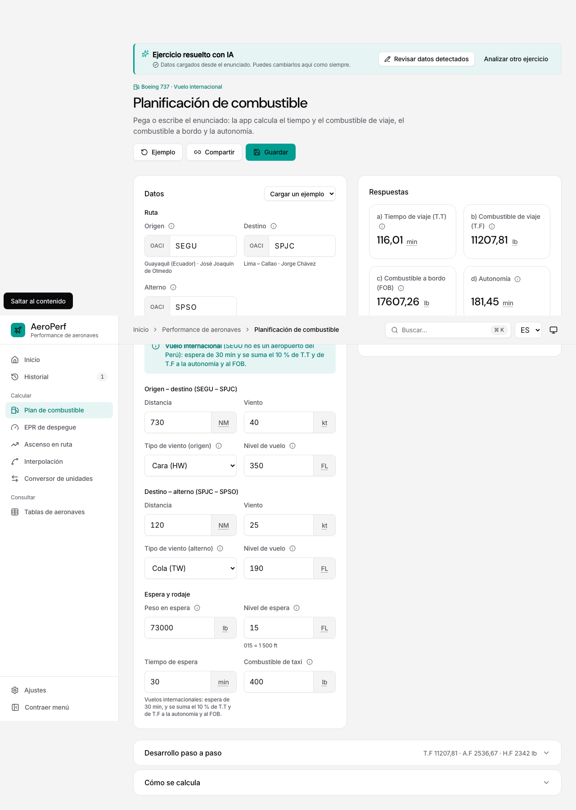
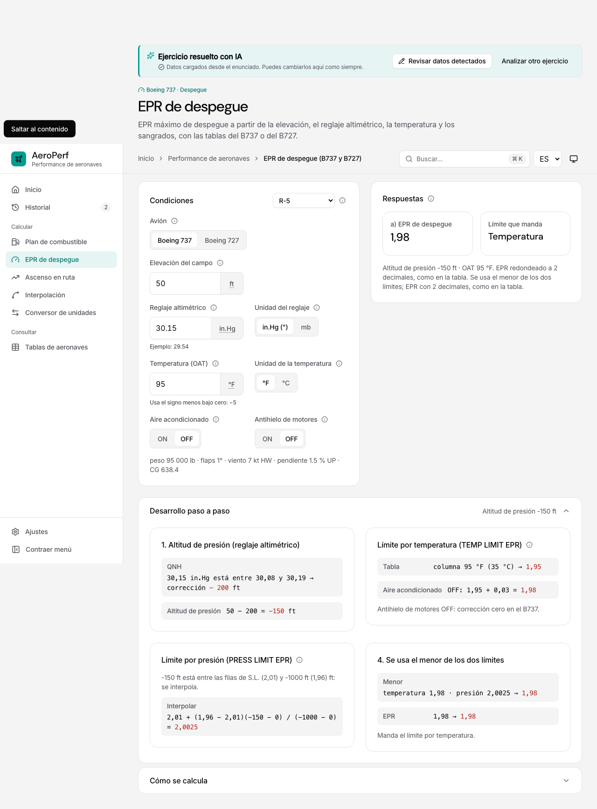
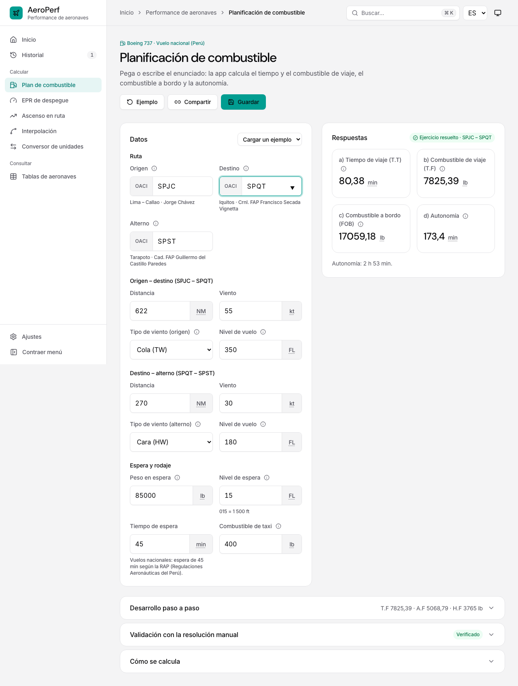

# Integración con los módulos

Cada paso de un análisis apunta a un módulo de la lista cerrada `AI_MODULES`. Los campos son los de `MODULE_FIELDS` y sus claves coinciden con los parámetros de URL de la calculadora.

| Módulo (`id`) | Campos (`MODULE_FIELDS`) | Motor | Salidas enlazables |
|---|---|---|---|
| Plan de combustible (`fuel`) | `aircraft` (B737), `dep`, `dst`, `alt` (OACI), `td`/`ad` NM, `tw`/`aw` kt, `tk`/`ak` HW/TW, `tfl`/`afl` FL (opcionales), `hw` lb, `hfl` FL, `hm` min, `taxi` lb | `solveFuelPlan` (FIGURE 67/69); vuelo internacional si un aeropuerto no empieza por SP | `fobLb`, `enduranceMin` |
| EPR de despegue (`takeoff-epr`) | `av` (b737/b727), `elev` ft, `qnh` + `qu` (inHg/mb), `oat` + `tu` (C/F), `ac`, `ai` (on/off), `b6` (on/off, obligatorio en el B727) | `solveB737TakeoffEpr` (FIGURE 54/55) o `solveTakeoffEpr` (FIGURE 82/83) | — |
| Ascenso en ruta (`en-route-climb`) | `aircraft` (B737), `w` lb, `alt` ft, `elev` ft, `t` (ISA/ISA10), `wind` kt, `wk` (HW/TW) | `solveEnRouteClimb` (FIGURE 57/58) | `fuelLb`, `distNm` |
| Interpolación (`linear`) | `a`, `b`, `c`, `a1`, `b1` | `linearInterpolate` | `x` |
| Interpolación doble (`bilinear`) | `x1`, `x`, `x2`, `y1`, `y`, `y2`, `q11`, `q21`, `q12`, `q22` | `bilinearInterpolate` | `value` |
| Conversor (`units`) | `q` (magnitud), `v`, `u` (origen), `to` (destino) | `convert` | `value` |

## Identificación de la aeronave

El prompt admite identificar la aeronave por las referencias FAA del enunciado y cita la referencia como evidencia:

| Referencia | Aeronave |
|---|---|
| FIGURE 53/54/55 o condiciones R-1 a R-5 | B737, despegue |
| FIGURE 81/82/83 o condiciones G-1 a G-5 | B727, despegue |
| FIGURE 56/57/58 o condiciones V-1 a V-5 | B737, ascenso en ruta |
| FIGURE 66/67/69 | B737, combustible |

En el B727, «AIR COND ENGS 1 AND 3», «ANTI-ICE ENG 2» y «6TH STAGE BLEED» corresponden exactamente a `ac`, `ai` y `b6`. Un sangrado que no figura nunca se supone: queda como «Falta».

## Validaciones (antes de llamar al motor)

- **Datos obligatorios**: si falta uno, el campo se marca en rojo («Falta») y el botón de cálculo queda bloqueado.
- **Opciones y códigos**: solo valores de la lista; códigos OACI de 4 letras; destino y alterno distintos.
- **Valores negativos o nulos**: se rechazan distancias, vientos, pesos y tiempos negativos, y un peso o tiempo de espera igual a cero.
- **Unidades**:
  - Deben ser explícitas. Una conversión solo se hace dentro de la misma magnitud y se muestra en el procedimiento.
  - La unidad de `qnh`, `oat` y `v` la fija su propio selector (`qu`, `tu`, `u`).
- **Rangos de las tablas**: los aplica el propio motor. Por ejemplo, «El peso 13000 lb está fuera de la tabla».

## Supuestos documentados

Solo se proponen los que el módulo ya aplica. Aparecen en naranja («Supuesto»), con su justificación como evidencia, y se pueden cambiar:

- **Plan de combustible, nivel de espera:** si el enunciado no lo da, 1 500 ft (FL 015), como en los ejercicios del curso.
- **Plan de combustible, tiempo de espera:** 45 min en vuelo nacional (RAP) o 30 min en internacional, según los códigos OACI.

## Estados de los datos en la revisión

| Estado | Significado |
|---|---|
| Verde | Leído del enunciado |
| Naranja | Supuesto |
| Rojo | Falta |
| Azul | Corregido por el usuario |
| Gris | De un paso anterior, u opcional |

Al pasar el ratón por ⓘ se ve la evidencia de cada dato.

## Varios pasos

- El análisis puede devolver pasos ordenados con `dependsOn` y `bindings`. Por ejemplo, una interpolación cuyo `x` alimenta el `v` de una conversión.
- Un paso con una dependencia pendiente no se puede calcular.
- «Siguiente: módulo» (en la barra de la calculadora o en la revisión) lleva a la revisión del paso siguiente conservando la sesión, con la ruta controlada `aiStepHref`.
- Cambiar un dato invalida el resultado de ese paso y de los que dependen de él.

## La calculadora real con los datos

«Confirmar y calcular» abre directamente la calculadora normal del módulo (`aiToolHref`), con **todas** las claves del módulo en la URL, también las vacías, más `from=<sesión>&step=<paso>`. Así la calculadora no completa ningún campo con los valores de su ejemplo, y el usuario sigue el flujo de siempre: desarrollo, tablas, «Guardar», «Compartir». La calculadora vuelve a calcular con su propio motor: con SEGU – SPJC muestra las mismas respuestas (116,01 · 11207,81 · 17607,26 · 181,45).

- Encima aparece la barra del asistente (`AIToolBanner`): volver a «Revisar datos detectados», «Siguiente: <módulo>» en ejercicios de varios pasos y «Analizar otro ejercicio».
- En Plan de combustible, los datos revisados llegan directamente a la tarjeta «Datos». El enunciado original queda en la revisión («Revisar datos detectados»), no en la calculadora.
- Desde la revisión, «Ver en <módulo>» vuelve a la calculadora sin recalcular.

## Plan de combustible sin tarjeta de enunciado

Plan de combustible ya no tiene la tarjeta «Enunciado»: ni texto, ni «Foto», ni «Imagen», ni pegar o arrastrar. La calculadora solo tiene la tarjeta «Datos», con «Cargar un ejemplo», y las respuestas. Los enunciados, escritos o en foto, se interpretan solo desde «Resolver ejercicio con IA», en Inicio, que revisa los datos y después abre esta calculadora con ellos.

## Referencias a tablas de condiciones (V-x, R-x, G-x)

Muchos enunciados solo citan las condiciones del ejercicio, por ejemplo «para condiciones V-5, figuras 56, 57 y 58». En ese caso los datos no están en el enunciado, sino en la tabla de condiciones digitalizada. `src/services/aiReferences.ts` (`withScenarioReference`) los rellena desde esa tabla:

| Referencia | Tabla | Módulo | Campos |
| --- | --- | --- | --- |
| V-1…V-5 | FIGURE 56 (B737) | Ascenso en ruta | aircraft, w, alt, elev, t, wind, wk |
| R-1…R-5 | FIGURE 53 (B737) | EPR de despegue | av, elev, qnh/qu, oat/tu, ac, ai |
| G-1…G-5 | FIGURE 81 (B727) | EPR de despegue | av, elev, qnh/qu, oat/tu, ac, ai, b6 |

Reglas:
- **Fuente propia:** los valores llevan `source: 'reference'`, que en la revisión se muestra en verde como «De la tabla de condiciones», con la fila de la fuente como evidencia (p. ej. «FIGURE 56 · condiciones V-5: AVG WIND COMP 40 HW»). El modelo no puede producir esta fuente: el esquema del servidor solo admite `statement` y `assumed`.
- **Prioridad del enunciado:** solo se rellenan campos vacíos; un dato explícito del enunciado nunca se sustituye.
- **Referencia inequívoca:** se exige una sola referencia y un contexto coherente (ascenso/climb o figuras 56–58 para V; EPR/despegue o figuras 53–55 y 81–83 para R y G). Con varias referencias, decide el usuario.
- **Paso garantizado:** si el modelo no creó el paso, se crea para el módulo de la tabla.
- **Sin llamada a Claude:** un enunciado de texto que solo cita condiciones se resuelve con el analizador local.
