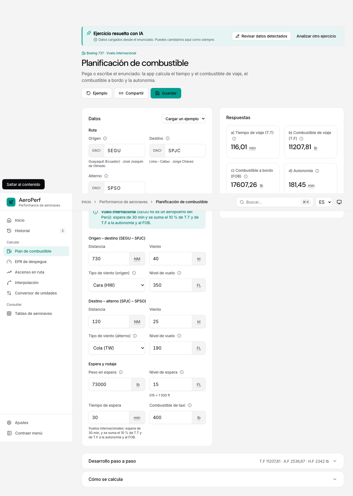
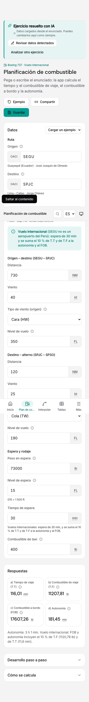
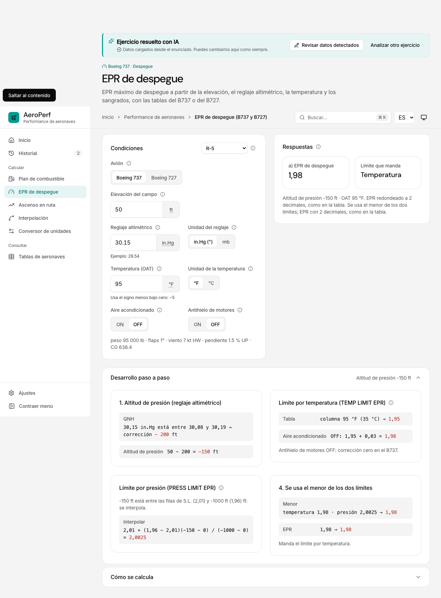
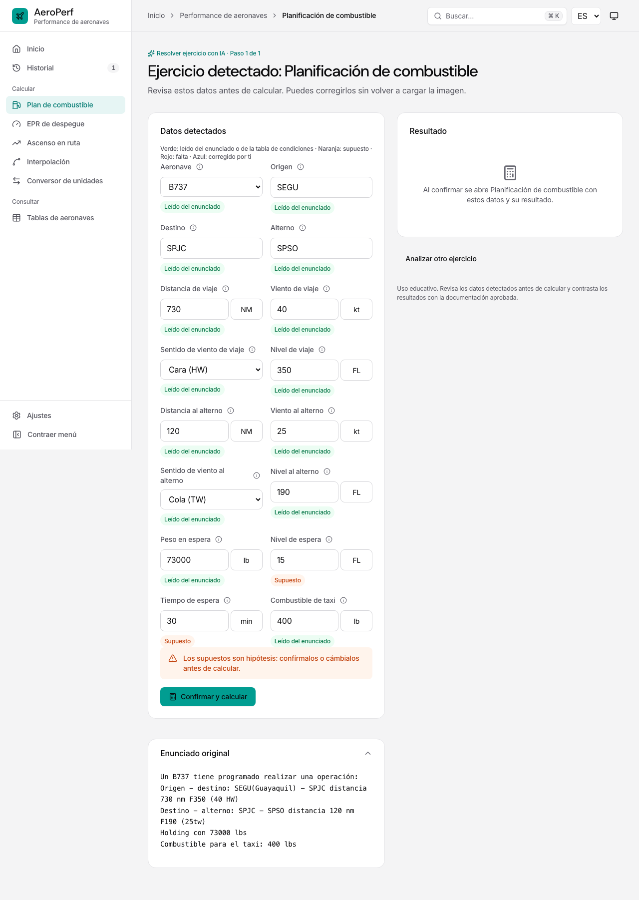
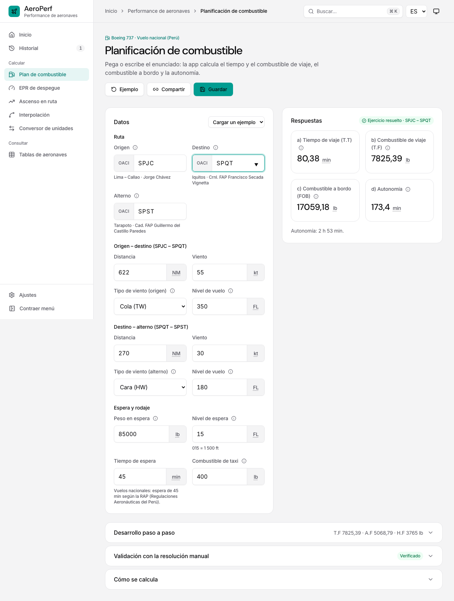

# Pruebas de AeroPerf AI

Este documento solo recoge pruebas ejecutadas el 5 de noviembre de 2026, sobre el código local.

## Pruebas automáticas (vitest)

- **Suite completa**: `npx vitest run` → **256 pruebas en 18 archivos**, todas aprobadas. Además, `tsc -b` y `npm run build` son correctos.
- **Flujo del asistente**: `src/components/ai/aiWorkflow.test.tsx`, 7 casos:
  1. **Combustible SEGU – SPJC**: datos leídos en verde, nivel y tiempo de espera supuestos en naranja (FL 015 y 30 min, vuelo internacional) y resultado **FOB 17607,26 lb · 181,45 min**. Deja una sola entrada de Historial, con el enunciado original y el resultado.
  2. **Correcciones**: cambiar la espera a 45 min la marca «Corregido» (`source: user`, `verified: true`) y recalcula la autonomía (196,45 min).
  3. **Dato imprescindible ausente** (B1): «Falta», botón bloqueado y aviso.
  4. **EPR B737 R-5**: la unidad del reglaje la fija su selector; resultado **EPR 1,98**.
  5. **Ruta controlada**: un paso de conversión abierto en `/tools/linear` redirige a `/tools/units`; resultado 100 NM = 185,2 km.
  6. **Borrado**: eliminar la entrada del Historial elimina la sesión, y la ruta muestra «No se encontró este ejercicio».
  7. **Dos pasos** (interpolación → conversión, con datos sintéticos): el segundo no se puede calcular antes del primero, usa `x` = 92,08 y deja una sola entrada de Historial.
- **Servidor**: `src/services/claudeServer.test.ts`, **25 pruebas**: las 19 previas sin cambios y 6 del modo `exercise`:
  - texto e imagen correctos;
  - respuesta inválida del modelo → 502;
  - `context` inválido → 400;
  - sin datos → 400;
  - el modo antiguo sigue intacto.

## Navegador (Chromium con Playwright, servidor de desarrollo)

- **Análisis local, sin red**:
  - combustible SEGU – SPJC → FOB 17607,26 lb · 181,45 min; «Abrir en Plan de combustible» muestra 116,01 · 11207,81 · 17607,26 · 181,45;
  - «convierte 100 NM a km» → 185,2 km;
  - interpolación → X = 92,08;
  - EPR B737 R-5 → 1,98.
- **Inglés a 390 px**: «convert 250 kt to km/h» → 463 km/h, sin desbordamiento horizontal.
- **Accesibilidad (axe-core, WCAG 2.2 AA)**: 0 infracciones y sin desbordamientos en Inicio con el asistente, en la revisión con resultado y en el asistente compacto de Ascenso en ruta. Comprobado en ES y EN, a 1280 y 390 px.
- **Errores de JavaScript**: ninguno en todos los recorridos.

## Claude real (servidor local con la clave de `.env.local`)

Estas pruebas envían los datos a Anthropic.

- **Enunciado incompleto** («Un B737 con combustible para el taxi de 400 lbs»): la revisión se abrió con los datos que faltaban en rojo y el cálculo bloqueado.
- **Foto real de combustible SEGU – SPJC** (manuscrita):
  - Análisis en unos 8 s: módulo, ruta, distancias, vientos y niveles leídos.
  - El peso de espera manuscrito «73000» se leyó como **13000**. El motor bloqueó el cálculo con «El peso 13000 lb está fuera de la tabla».
  - Tras corregirlo a 73000 en la revisión, sin volver a subir la imagen, el resultado fue **FOB 17607,26 lb · 181,45 min**, igual que la resolución manual.
- **Foto real de EPR G-5**:
  - Identificó el **B727** por la FIGURE 81 y leyó elevación, reglaje, OAT y sangrados.
  - La sexta etapa no figura en la foto, así que quedó como «Falta» y el cálculo bloqueado.
  - Con OFF, el resultado fue **2,24 y 2,22**, igual que la resolución.
- **Defecto encontrado y corregido**: antes de ajustar `AI_SYSTEM_PROMPT`, las dos fotos devolvían `steps=[]`. El modelo descartaba el ejercicio cuando faltaba un dato, en lugar de crear el paso con los datos faltantes marcados.

## No probado

- Una imagen borrosa o ilegible real (prueba 8 del encargo).
- Un ejercicio combinado real interpretado por Claude: el de dos pasos solo se probó con datos sintéticos.
- La cámara en Safari/iOS y en Android real; el selector `capture` solo se verificó en el DOM.
- Pegar desde el portapapeles con `navigator.clipboard.read`, que necesita un permiso real del navegador.
- Lectores de pantalla (VoiceOver, NVDA).
- Ascenso en ruta, interpolación doble y conversión a partir de imágenes reales.

## Correcciones tras la revisión de la documentación

Detectadas al capturar el manual y verificadas después en Chromium:

- **Enunciado al abrir el módulo:** al pulsar «Abrir en el módulo», Plan de combustible muestra el enunciado original como referencia (`from=<sesión>`). Los datos revisados no se vuelven a interpretar y las respuestas siguen siendo 116,01 · 11207,81 · 17607,26 · 181,45.
- **Unidades en la revisión:** cada unidad va en la misma fila que su valor. La tarjeta de datos de combustible pasa a medir unos 970 px a 1280 px de ancho.
- **Desborde a 390 px:** el botón «Abrir en Planificación de combustible con estos datos» desbordaba 47 px; ahora parte su texto en varias líneas. axe queda sin infracciones y sin desbordes en Inicio, la revisión y el asistente compacto, en ES/EN y a 1280/390 px.
- **Regresión del resto de la app:** 57 pantallas por tema (claro y oscuro) sin infracciones de axe, sin desbordes ni errores de JavaScript; la sonda de interacción pasa 24 de 24.

## Foto con solo la referencia «condiciones V-5» (caso reportado por el usuario)

- **Antes:** la foto «Determinar la distancia recorrida durante un ascenso en ruta para condiciones V-5, figuras 56, 57 y 58» se clasificaba bien (Ascenso en ruta, B737), pero los seis datos quedaban en «Falta» y el cálculo se bloqueaba. Además, en columnas estrechas el valor quedaba aplastado junto a su unidad.
- **Después (Claude real, misma foto, 1280 y 390 px):** peso 75000 lb, altitud 31000 ft, elevación 2000 ft, ISA +10 °C y viento 40 kt HW, marcados «De la tabla de condiciones». Resultado: **2000 lb · 61,33 NM**, igual que las dos resoluciones manuales.
- **Mismo enunciado como texto:** se resuelve en local, sin llamadas a `/api/analyze-statement`. «condiciones G-5, figuras 81, 82 y 83» da 2,24 / 2,22.
- **Pruebas automáticas:** `src/services/aiReferences.test.ts`, 4 casos (V-5 → 61,33 NM y 2000 lb; G-5 → 2,24/2,22; R-5 → 1,98; prioridad del enunciado; creación del paso; rechazo de referencias ambiguas o sin contexto). Total: **260 pruebas en 19 archivos**.
- **Interfaz:** los desplegables de la revisión muestran textos legibles («Boeing 727», «ISA +10 °C», «Cara (HW)», «in.Hg (")», «NM») y conservan el valor interno. axe sin infracciones en ES/EN a 1280 y 390 px.

## La calculadora real tras «Confirmar y calcular» (caso reportado por el usuario)

- **Antes:** tras confirmar, la revisión mostraba su propia tarjeta de resultado, con su procedimiento y el botón «Abrir en <módulo> con estos datos». Se perdía el flujo normal de la calculadora (desarrollo completo, tablas, «Guardar», «Compartir»).
- **Después:** «Confirmar y calcular» valida con el motor de la app, guarda el resultado en la sesión y abre la calculadora real con todos los datos (`/tools/<módulo>?<claves>&from=<sesión>&step=<paso>`). Encima aparece la barra «Ejercicio resuelto con IA» con «Revisar datos detectados», «Siguiente: <módulo>» y «Analizar otro ejercicio». El Historial abre esa misma calculadora.
- **Defecto encontrado y corregido:** el parámetro de la revisión era `?ai=`, la misma clave que el antihielo de EPR de despegue. Al abrir EPR con `ai=off`, la página buscaba la sesión «off» y mostraba «No se encontró este ejercicio». Ahora la revisión usa `?aiReview=`; una prueba comprueba que `ai=off` llega a la calculadora sin confundirse.
- **Pruebas automáticas** (`src/components/ai/aiWorkflow.test.tsx`, 7 casos): tras confirmar ya no buscan la tarjeta `.ai-result-summary`. Comprueban la calculadora real:
  - la URL lleva `from=` y no queda ninguna revisión en pantalla;
  - la barra del asistente está visible;
  - aparecen los valores 17607,26 y 181,45 (combustible), 1,98 (EPR R-5), 185,2 (conversor), 92,08 y 170,53 (dos pasos, con «Paso 1 de 2» y «Siguiente: Conversor de unidades» en la barra);
  - la calculadora de combustible recibe los datos revisados en «Datos» (origen SEGU, distancia 730) y no tiene campo de enunciado;
  - el Historial apunta a `/tools/fuel?…from=`;
  - «Revisar datos detectados» vuelve a la revisión con el resumen, y «Ver en Planificación de combustible» regresa a la calculadora.

## Plan de combustible sin captura de fotos (caso reportado por el usuario)

- **Cambio:** la tarjeta «Enunciado» de Plan de combustible tenía su propia captura («Foto», «Imagen», pegar con Ctrl+V y arrastrar), que duplicaba la de Inicio. Se quitó: las fotos se analizan solo desde «Resolver ejercicio con IA», en Inicio. La tarjeta conserva el texto, los ejemplos y el botón de borrar, y enlaza a Inicio («¿Tienes una foto del ejercicio? Analízala desde Inicio con IA»).
- **Pruebas automáticas** (`src/app.test.tsx`): se retiraron las 5 pruebas de subida de imagen en Plan de combustible (datos de Claude, editar tras la foto, foto en curso, respuesta pendiente y error de Claude). La captura de imágenes ya se prueba en el asistente de Inicio. Una prueba nueva comprueba que no hay botones «Foto» ni «Imagen» ni campo de subida, y que el enlace lleva a Inicio (`#/`). El caso «si faltan datos» ahora usa un enunciado de texto incompleto.
- **Suite completa:** `npx tsc -b` sin errores; `npx vitest run` → **254 pruebas en 19 archivos**, todas aprobadas.

## Plan de combustible sin tarjeta de enunciado (caso reportado por el usuario)

- **Cambio:** se retiró la tarjeta «Enunciado» completa de Plan de combustible (`StatementBox` se eliminó, con sus chips de datos detectados, «Completar a mano», el estado «Revisado con IA» y el enlace a Inicio). La calculadora solo tiene la tarjeta «Datos», con «Cargar un ejemplo», y las respuestas. Los enunciados, escritos o en foto, se interpretan solo desde «Resolver ejercicio con IA», en Inicio.
- **Pruebas automáticas:**
  - `src/app.test.tsx`: el bloque «resolver desde el enunciado» se sustituyó por «combustible sin enunciado propio». Comprueba que no hay tarjeta de enunciado, ni botones de foto, ni `textarea`; que el ejemplo se resuelve (80,38 · 7825,39 · 17059,18 · 173,4); que «Cargar un ejemplo» repone los datos; y que un enlace con datos (Historial) calcula.
  - `src/ux.test.tsx`: el caso internacional SEGU – SPJC rellena los campos de «Datos» en lugar del enunciado y sigue dando 116,01 · 11207,81 · 17607,26 · 181,45, con la espera en 30 min.
  - `src/components/ai/aiWorkflow.test.tsx`: tras confirmar, la calculadora de combustible muestra origen SEGU y distancia 730 en «Datos», sin `textarea`.
- **Suite completa:** `npx tsc -b` sin errores; `npx vitest run` → **252 pruebas en 19 archivos**, todas aprobadas.

## Cifra manuscrita dudosa: «Lectura dudosa» (caso reportado por el usuario)

- **Caso:** foto manuscrita del ejercicio SEGU – SPJC. En «Holding con 73000 lbs» el primer dígito parece un «?».
- **Antes:** Claude omitía el peso en espera en 2 de 2 intentos, porque la regla era «ilegible = se omite». En uno de ellos incluso escribía en sus avisos que leía «73000 lbs». La revisión mostraba «Peso en espera» en rojo («Falta») sin explicación, porque los avisos del análisis no aparecían en pantalla.
- **Cambio:**
  - Nueva fuente `uncertain` en `AIField`. El esquema la admite (`statement`, `assumed`, `uncertain`) y `normalizeAIAnalysis` le exige evidencia.
  - `AI_SYSTEM_PROMPT` distingue lo dudoso de lo ilegible. Si la cifra se lee pero duda un carácter, devuelve la lectura más probable, una evidencia que nombra el carácter dudoso y la alternativa, y un aviso, con un criterio de plausibilidad (peso en espera del B737 entre 60 000 y 110 000 lb). Lo ausente o del todo ilegible se sigue omitiendo. Los códigos OACI dudosos se resuelven con la ciudad escrita al lado (Guayaquil = SEGU).
  - En la revisión, el estado nuevo es naranja, «Lectura dudosa» («Doubtful reading»), con el aviso «Hay lecturas dudosas de la letra manuscrita…». Los avisos del análisis se listan en «Datos detectados» («Avisos del análisis»). La leyenda dice «Naranja: supuesto o lectura dudosa».
- **Claude real** (la foto del usuario se envió a Anthropic a través del servidor local): en 3 de 3 intentos devolvió `hw = 73000`, `source: uncertain`, con evidencia del tipo «el primer dígito podría ser 7 o 1; 7 es más probable» y un aviso para confirmarlo. Con 73000 lb, el resultado es FOB 17607,26 lb · 181,45 min.
- **Pruebas automáticas:** se actualizaron las de `normalizeAIAnalysis` (acepta `uncertain` y exige su evidencia) y las de la revisión (estado «Lectura dudosa» y lista de avisos).

