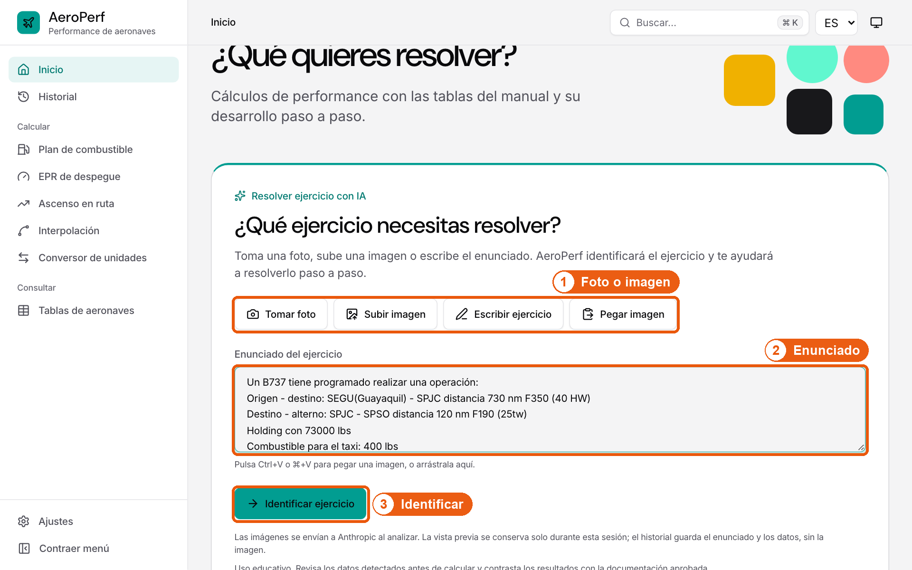
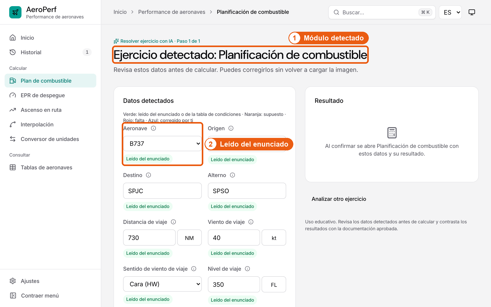
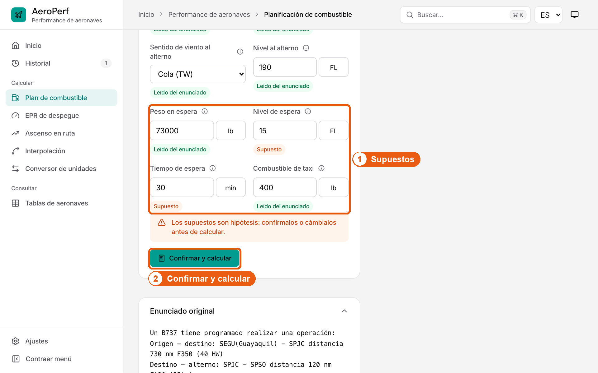
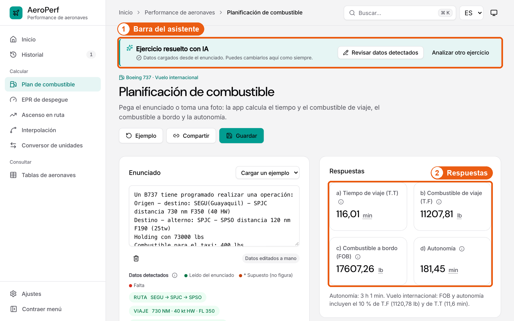
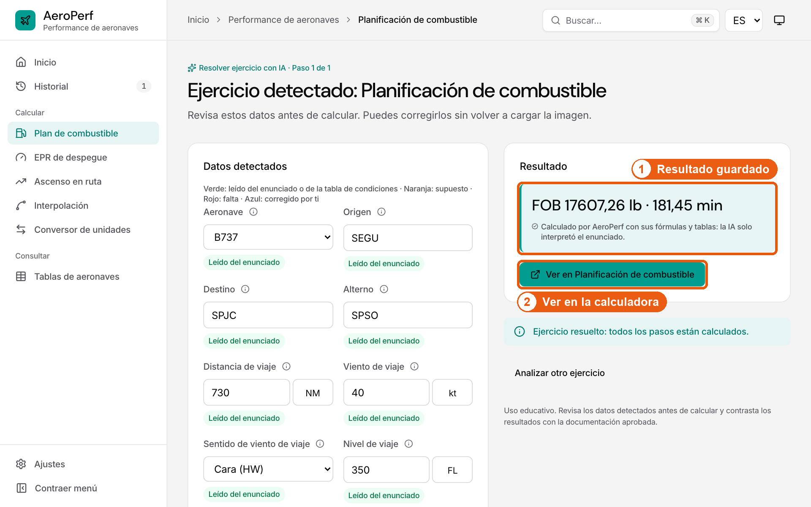
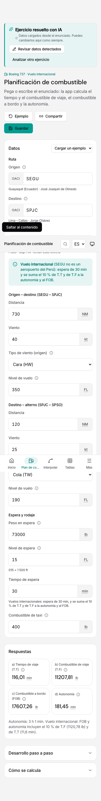
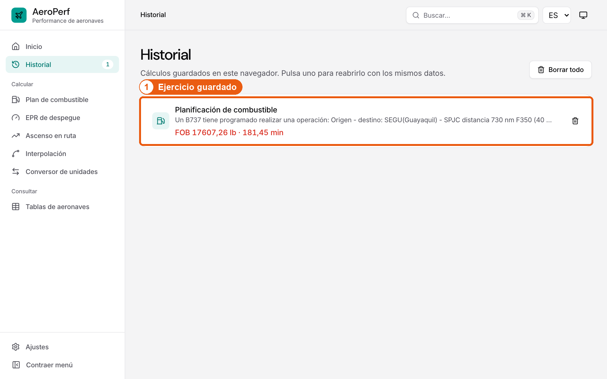

# Manual: resolver un ejercicio con IA

Esta guía explica, en cinco pasos, cómo resolver un ejercicio con el asistente de AeroPerf. Las capturas son de la versión final; los números naranjas indican el orden de las acciones.

## 1. Escribe o fotografía el ejercicio

En **Inicio**, en la tarjeta «Resolver ejercicio con IA»:

1. **Foto o imagen:**
   - **Tomar foto** abre la cámara del móvil.
   - **Subir imagen** elige una foto o captura.
   - **Pegar imagen** la toma del portapapeles. También puedes pulsar Ctrl+V o ⌘+V, o arrastrarla a la tarjeta.
2. **Enunciado:** si no tienes foto, escribe o pega el texto del ejercicio con sus valores y unidades.
3. **Identificar:** pulsa «Identificar ejercicio».

La imagen se envía a Anthropic (Claude) solo para leer el enunciado. AeroPerf no la guarda: la vista previa dura mientras la pestaña está abierta. En EPR, Ascenso en ruta, Interpolación y Conversor encontrarás el mismo asistente en el botón «Interpretar un enunciado o una imagen con IA».

## 2. Revisa los datos detectados

AeroPerf abre el módulo correcto y muestra lo que leyó.

1. **Módulo detectado:** el tipo de ejercicio, por ejemplo Planificación de combustible.
2. **Leído del enunciado:** los datos en verde aparecen tal cual en el ejercicio. Toca ⓘ para ver la frase de donde salen.

> **Lectura dudosa (naranja):** si una cifra escrita a mano no se distingue bien (por ejemplo, un 7 que parece un 1), el asistente propone la lectura más probable y la marca en naranja. Compárala con la imagen en «Enunciado original» y corrígela si hace falta. En «Avisos del análisis», en la misma tarjeta, se explica qué dato es dudoso y por qué.

## 3. Confirma los supuestos y calcula

1. **Supuestos (naranja):** son datos que no figuran en el enunciado y la app propone con una regla del curso; por ejemplo, la espera a FL 015 y 30 min en un vuelo internacional. Cámbialos si tu ejercicio dice otra cosa.
2. **Confirmar y calcular:** se activa cuando no falta nada. Un dato en **rojo («Falta»)** hay que escribirlo, y uno que corriges se pone **azul («Corregido»)**. No hace falta volver a subir la imagen.

## 4. Sigue en la calculadora normal

Al confirmar, AeroPerf abre la calculadora de siempre del módulo, con tus datos ya cargados y su resultado calculado. Puedes ver el desarrollo completo, cambiar un dato, guardar o compartir, como en cualquier cálculo.

1. **Barra del asistente:** indica «Ejercicio resuelto con IA» y, si el ejercicio tiene varios pasos, en cuál estás. Desde ella puedes **Revisar datos detectados**, pasar al **Siguiente** módulo (por ejemplo, interpolar y luego convertir) o **Analizar otro ejercicio**.
2. **Respuestas:** las calcula la calculadora con sus fórmulas y tablas (en el ejemplo, FOB 17607,26 lb y autonomía 181,45 min). La IA solo interpretó el enunciado.

Si vuelves a la revisión, verás el resultado guardado y el botón para regresar a la calculadora:

1. **Resultado guardado:** el resumen que calculó AeroPerf.
2. **Ver en <módulo>:** vuelve a la calculadora con los mismos datos.

> **Plan de combustible:** ya no tiene tarjeta de enunciado. Escribe, pega o fotografía el ejercicio en «Resolver ejercicio con IA», en Inicio; tras revisar, la calculadora se abre con los datos en «Datos».

## 5. Retómalo desde el Historial

1. **Ejercicio guardado:** cada ejercicio queda como una sola entrada, aunque use varios módulos. Púlsala para abrir su calculadora con los datos; si aún no se calculó, vuelve a la revisión y aparece «IA · pendiente de revisar». La papelera lo borra junto con sus datos.

> **Ejercicios con varios pasos:** si un ejercicio necesita varios módulos (por ejemplo, interpolar y luego convertir), arriba verás los pasos numerados. Confirma cada uno y pulsa «Siguiente» en la barra de la calculadora.

> **Uso educativo:** revisa siempre los datos y contrasta los resultados con la documentación aprobada de la aeronave. Las tablas son material del curso (FAA), no datos operacionales.
