# Manual de usuario — AeroPerf

Guía breve y visual para usar AeroPerf, la aplicación de cálculos de performance de aeronaves. Actualizado el 5 de noviembre de 2026.

> El PDF todavía describe la navegación anterior; consulta esta versión para localizar las herramientas que no aparecen en el menú.

Los números naranjas de cada imagen indican el orden de las acciones.

## Contenido

1. Abrir la aplicación y conocer el inicio
2. Resolver un ejercicio de combustible
3. Hacer un cálculo y guardarlo
4. Calcular el EPR de despegue (B737 y B727)
5. Calcular el ascenso en ruta (B737)
6. Entender los mensajes
7. Consultar el historial
8. Consultar tablas y pruebas
9. Ajustes
10. Usar la app en el móvil
11. Interpretar los mensajes
12. Glosario rápido

## 1. Abrir la aplicación y conocer el inicio

AeroPerf se abre en el navegador; no necesita usuario ni contraseña. Tus cálculos y ajustes se guardan solo en este navegador.

### Pantalla de inicio

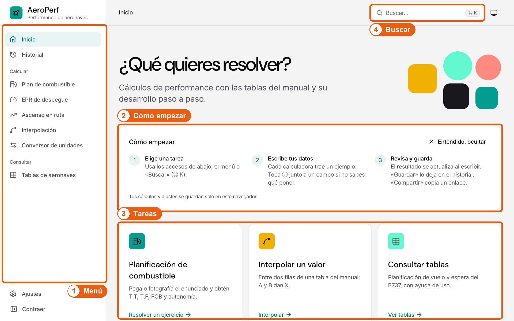

1. **Menú:** El menú lateral agrupa las herramientas principales en Calcular y Consultar. La opción resaltada indica dónde estás; las demás herramientas y las Pruebas se encuentran con «Buscar».
2. **Cómo empezar:** La primera vez verás tres pasos de orientación. Pulsa «Entendido, ocultar» cuando ya no los necesites.
3. **Tareas:** Los tres accesos directos llevan a las tareas más frecuentes.
4. **Buscar:** Busca cualquier herramienta, tabla o ejercicio por su nombre, también los que no están en el menú (por ejemplo «viento» o «pruebas»).

**Resultado:** Sabes dónde está cada herramienta y cómo empezar.

### Buscar una herramienta

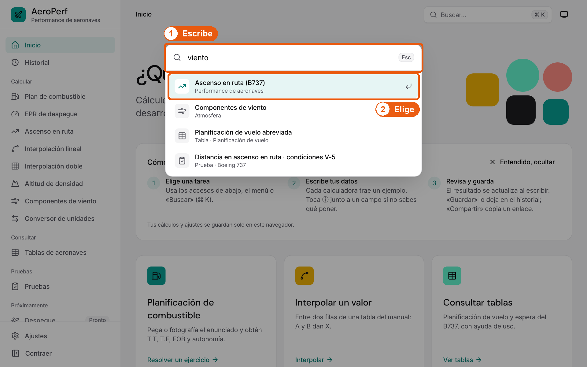

1. **Escribe:** Escribe una palabra, por ejemplo «viento». En el ordenador también puedes abrir la búsqueda con Ctrl K (⌘ K en Mac).
2. **Elige:** Pulsa el resultado o usa las flechas ↑ ↓ y Enter. Esc cierra la búsqueda.

**Resultado:** Se abre la herramienta elegida.

## 2. Resolver un ejercicio de combustible

La planificación de combustible calcula el tiempo y el combustible de viaje (T.T y T.F), el combustible a bordo (FOB) y la autonomía de un B737. Si origen, destino o alterno no es del Perú, el vuelo es internacional: espera de 30 min y se suma el 10 % de T.T y T.F.

### Desde un enunciado o una foto

La calculadora de combustible no tiene tarjeta de enunciado. Para resolver un ejercicio escrito o en foto, usa «Resolver ejercicio con IA» en Inicio: el asistente lee el enunciado, te deja revisar los datos y abre esta calculadora con todo cargado.

### Introducir los datos

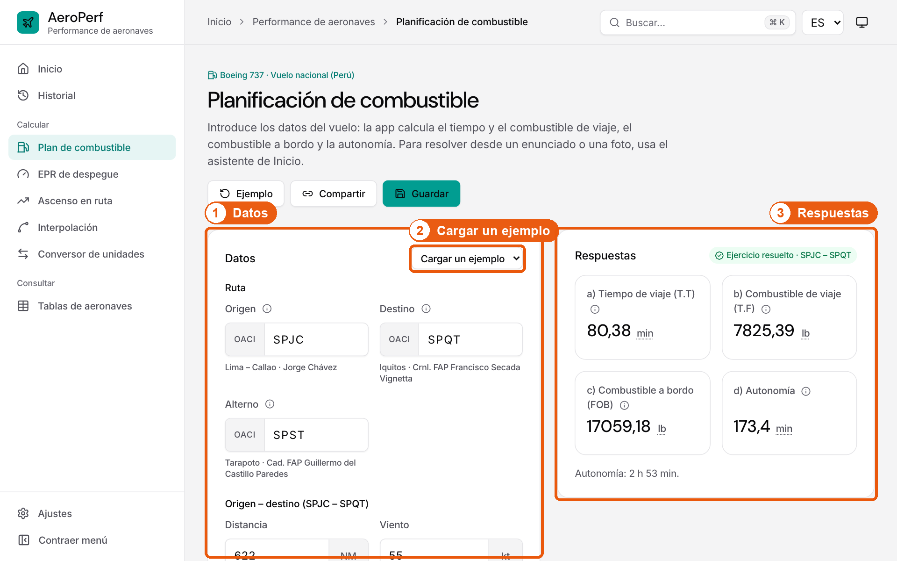

1. **Datos:** Escribe la ruta, las distancias, los vientos, los niveles, la espera y el taxi. Las respuestas se actualizan solas.
2. **Ejemplos:** «Cargar un ejemplo» rellena los datos de un ejercicio resuelto para ver cómo funciona.
3. **Respuestas:** Aquí aparecen T.T, T.F, FOB y autonomía. Toca ⓘ para ver qué significa cada sigla.

**Resultado:** Con los datos completos verás las cuatro respuestas.

### Revisar o corregir los datos

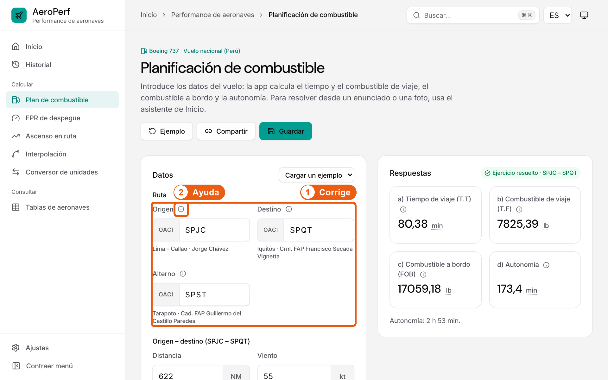

1. **Abre «Datos»:** Pulsa «Datos» para ver todos los valores que usa el cálculo.
2. **Corrige:** Cambia cualquier valor; las respuestas se recalculan al momento. Los códigos de aeropuerto son OACI de 4 letras (SP… en Perú).
3. **Ayuda:** Si no sabes qué poner, toca ⓘ junto al nombre del campo.

**Resultado:** Las respuestas usan los datos corregidos y el estado cambia a «Datos editados a mano».

## 3. Hacer un cálculo y guardarlo

Todas las calculadoras funcionan igual: escribe los datos, lee el resultado y, si quieres, guárdalo o compártelo. Se usa como ejemplo la interpolación lineal.

### Interpolación

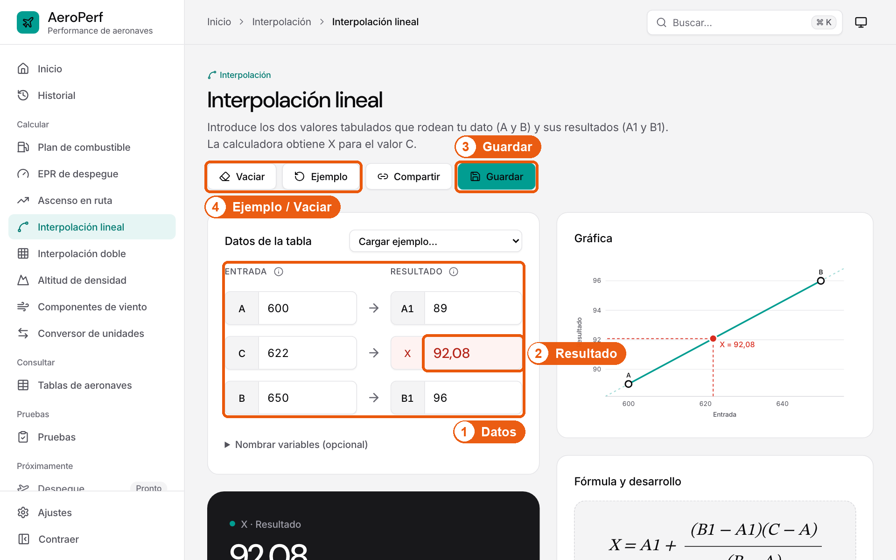

1. **Datos:** Escribe las dos filas de la tabla que rodean tu dato (A y B), tu dato (C) y los valores de la tabla (A1 y B1).
2. **Resultado:** X se calcula al escribir. Al lado verás la fórmula y el desarrollo paso a paso.
3. **Guardar:** «Guardar» lo añade al historial. «Compartir» copia un enlace con los mismos datos.
4. **Ejemplo / Vaciar:** «Ejemplo» carga datos de muestra y «Vaciar» borra los campos. Ambos se pueden deshacer.

**Resultado:** Aparece el aviso «Cálculo guardado en el historial».

### Usar las ayudas ⓘ

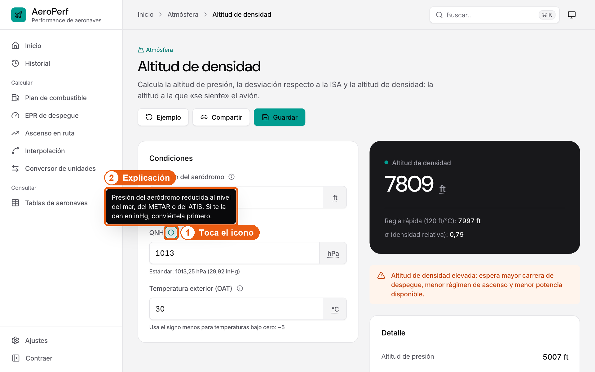

1. **Toca el icono:** Pasa el ratón, toca o enfoca con el teclado el icono ⓘ junto a un campo o sigla.
2. **Explicación:** Una o dos frases dicen qué es el dato y qué escribir. Se cierra al tocar fuera o con Esc. Las unidades subrayadas con puntos (ft, °F, lb, NM…) también explican su significado.

**Resultado:** Entiendes el dato sin salir de la pantalla.

## 4. Calcular el EPR de despegue (B737 y B727)

Calcula el EPR máximo de despegue con las tablas del B737 (límite por temperatura y por presión, se usa el menor) o del B727 (un EPR para los motores 1 y 3 y otro para el motor 2), igual que en la resolución a mano.

### EPR de despegue

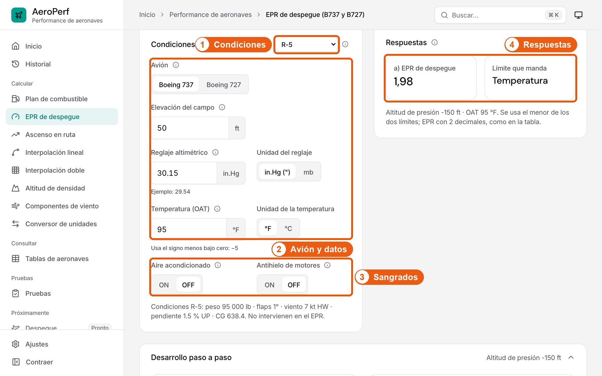

1. **Condiciones:** Elige R-1 a R-5 (B737) o G-1 a G-5 (B727) para cargar los datos del ejercicio, o escríbelos a mano.
2. **Avión y datos:** Comprueba el avión, la elevación, el reglaje (in.Hg o mb) y la temperatura (°F o °C).
3. **Sangrados:** Marca ON u OFF los sangrados (aire acondicionado, antihielo y, en el B727, la 6.ª etapa): cambian el EPR.
4. **Respuestas:** El EPR con 2 decimales y, en el B737, qué límite manda. Debajo está el desarrollo paso a paso.

**Resultado:** Con R-5 (B737) se obtiene 1,98; con G-5 (B727), 2,24 para los motores 1 y 3 y 2,22 para el motor 2.

## 5. Calcular el ascenso en ruta (B737)

Calcula el combustible consumido y la distancia recorrida en el ascenso hasta la altitud de crucero, con las tablas del B737 en ISA o ISA +10 °C.

### Ascenso en ruta

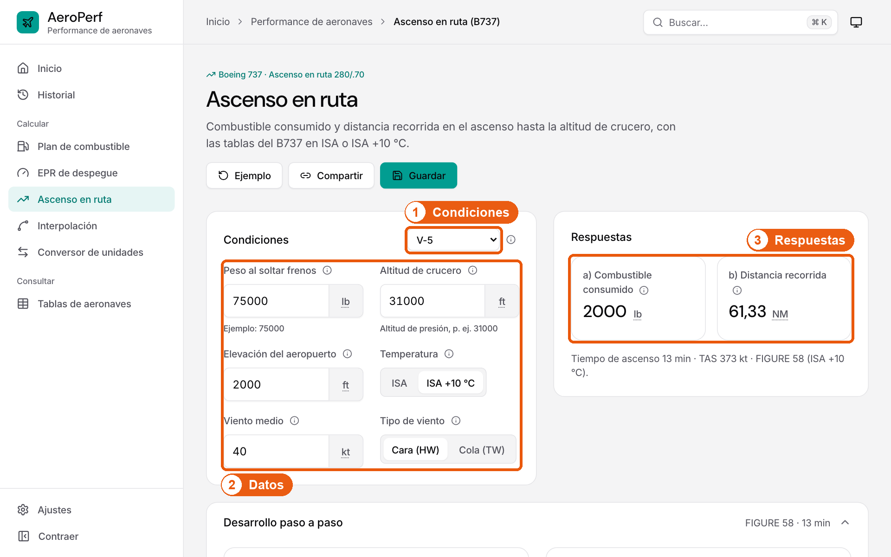

1. **Condiciones:** Elige V-1 a V-5 para cargar los datos del ejercicio, o escríbelos a mano.
2. **Datos:** Peso al soltar frenos, altitud de crucero, elevación del aeropuerto, temperatura (ISA o ISA +10 °C) y viento medio.
3. **Respuestas:** Combustible consumido (con el ajuste por aeropuerto elevado) y distancia recorrida (corregida por el viento con d = t · v).

**Resultado:** Con V-5 se obtienen 2000 lb y 61,33 NM; el desarrollo paso a paso aparece debajo.

## 6. Entender los mensajes

La app avisa en el momento y junto al dato: rojo para errores, naranja para advertencias y gris para orientación.

### Corregir un dato mal escrito

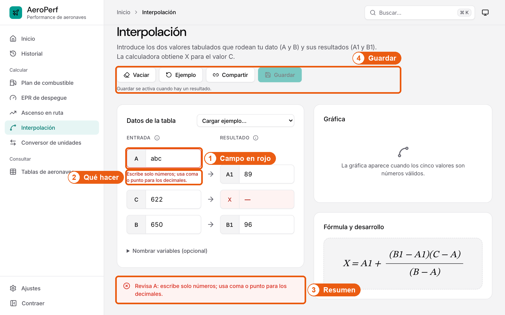

1. **Campo en rojo:** El borde rojo marca el campo que hay que corregir.
2. **Qué hacer:** Debajo del campo se explica cómo corregirlo.
3. **Resumen:** El aviso resume qué campos revisar.
4. **Guardar:** Guardar está desactivado hasta que haya un resultado; el texto de al lado lo explica.

**Resultado:** Al escribir un número válido el error desaparece y vuelve el resultado.

## 7. Consultar el historial

El historial guarda los cálculos que pulsaste «Guardar», para reabrirlos con los mismos datos.

### Filtrar, reabrir y eliminar

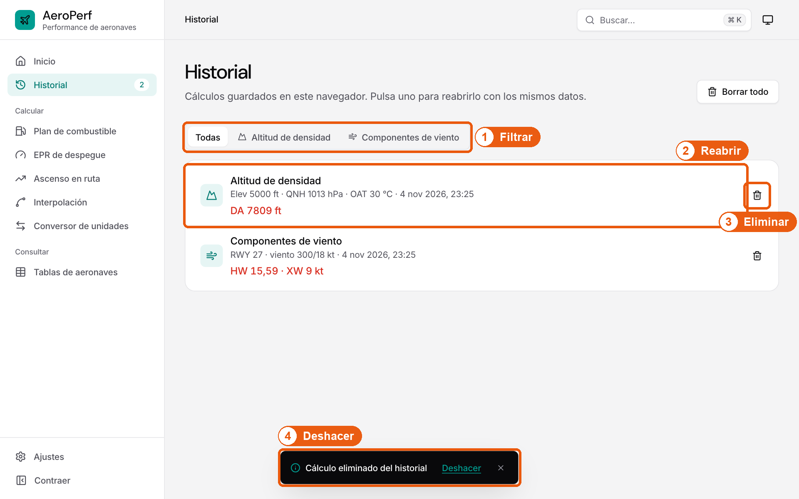

1. **Filtrar:** Muestra solo los cálculos de una herramienta.
2. **Reabrir:** Pulsa un cálculo para abrirlo con los mismos datos.
3. **Eliminar:** La papelera quita un cálculo del historial.
4. **Deshacer:** Durante unos segundos puedes recuperar lo eliminado con «Deshacer».

**Resultado:** «Borrar todo» pide confirmación y también se puede deshacer.

## 8. Consultar tablas y pruebas

Las tablas de performance (suplemento FAA) se consultan con su ayuda de uso. Las pruebas comparan la app con ejercicios resueltos a mano.

### Leer una tabla

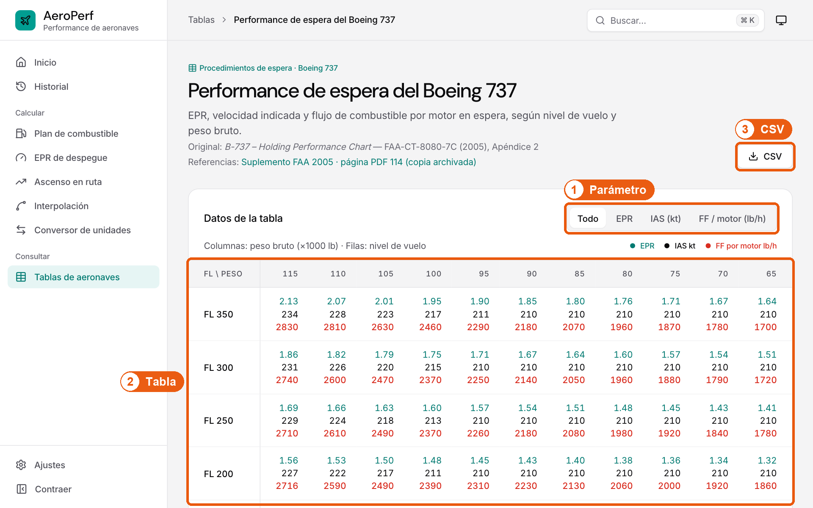

1. **Parámetro:** Elige qué valor ver en la tabla (por ejemplo, flujo de combustible).
2. **Tabla:** Desplaza la tabla hacia los lados si no cabe; con teclado, enfócala y usa las flechas.
3. **CSV:** Descarga la tabla para abrirla en una hoja de cálculo.

**Resultado:** Más abajo, la sección «Ayuda» explica para qué sirve la tabla, cómo leerla y su glosario.

### Revisar una prueba

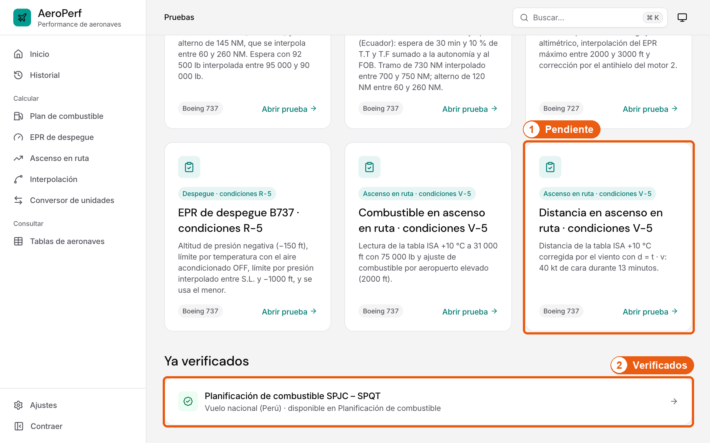

1. **Pendiente:** Abre Pruebas con «Buscar» (escribe «pruebas») y elige una para comparar cada paso de la app con la resolución manual.
2. **Verificados:** Los ejercicios ya verificados se abren directamente en su herramienta.

**Resultado:** Cada paso se marca como «Coincide», «Redondeo» o «Revisar».

## 9. Ajustes

Los ajustes se aplican al instante y se recuerdan en este navegador.

### Tema y decimales

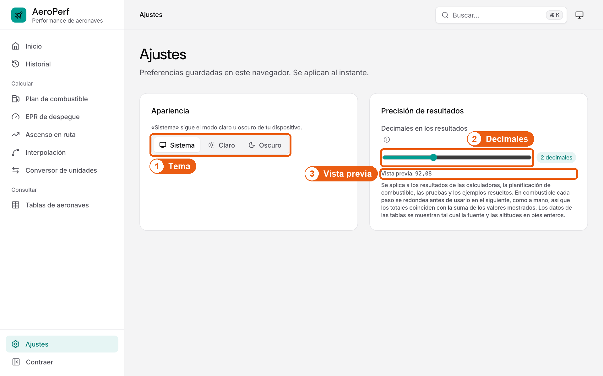

1. **Tema:** Claro, oscuro o el del sistema de tu dispositivo.
2. **Decimales:** Elige cuántos decimales mostrar en los resultados (0 a 6).
3. **Vista previa:** Comprueba cómo se verá un resultado.

**Resultado:** Los resultados de todas las calculadoras usan el nuevo formato.

## 10. Usar la app en el móvil

En pantallas pequeñas el menú se oculta y aparece una barra inferior con los accesos más usados.

### Barra inferior

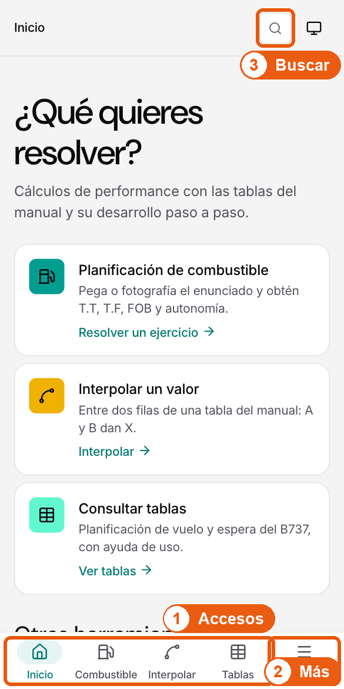

1. **Accesos:** Inicio, Combustible, Interpolar y Tablas a un toque.
2. **Más:** «Más» abre el menú completo.
3. **Buscar:** La lupa abre la búsqueda.

**Resultado:** Se abre la sección elegida.

### Menú completo

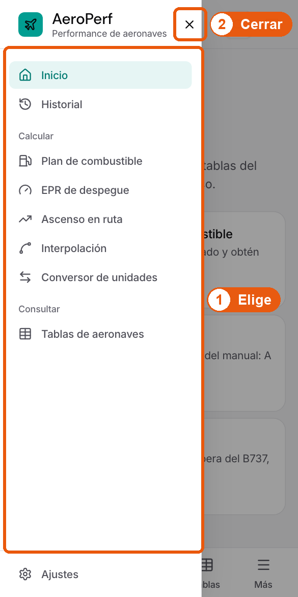

1. **Elige:** Toca una herramienta para abrirla; el menú se cierra solo.
2. **Cerrar:** Cierra el menú con la X, tocando fuera o con Esc.

**Resultado:** Vuelves a la pantalla en la que estabas.

## 11. Interpretar los mensajes

| Color | Significado |
| --- | --- |
| Rojo | Error: hay que corregir algo. El mensaje dice qué hacer. |
| Naranja | Advertencia: el cálculo es posible, pero revisa el dato (por ejemplo, extrapolación o viento de cola). |
| Gris | Orientación: falta un dato o cómo continuar. |
| Aviso negro abajo | Confirmación de una acción. Si tiene «Deshacer», puedes revertirla durante unos segundos. |

## 12. Glosario rápido

| Sigla | Qué es |
| --- | --- |
| T.T / T.F | Tiempo y combustible de viaje, de origen a destino. |
| A.T / A.F | Tiempo y combustible de destino a alterno. |
| FOB | Combustible a bordo: viaje + alterno + espera + taxi. |
| HW / TW | Viento de cara (suma) / viento de cola (resta). |
| FL | Nivel de vuelo en cientos de pies (FL 350 = 35 000 ft). |
| QNH / OAT | Presión reducida al nivel del mar / temperatura exterior. |
| OACI | Código de aeropuerto de 4 letras (SPJC = Lima). |

> AeroPerf es una herramienta de apoyo. Verifica siempre los resultados con la documentación oficial de la aeronave.
