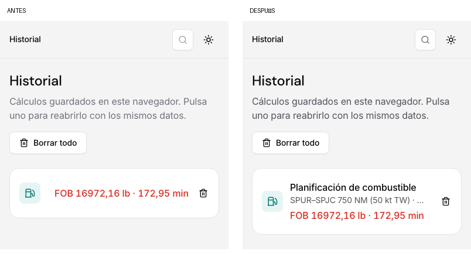
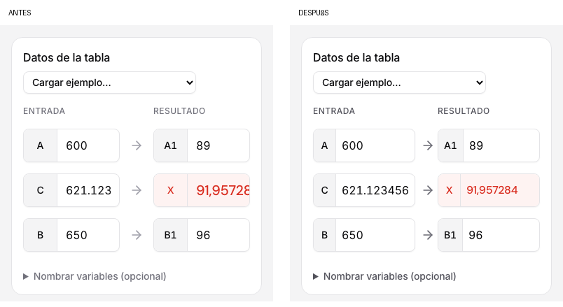
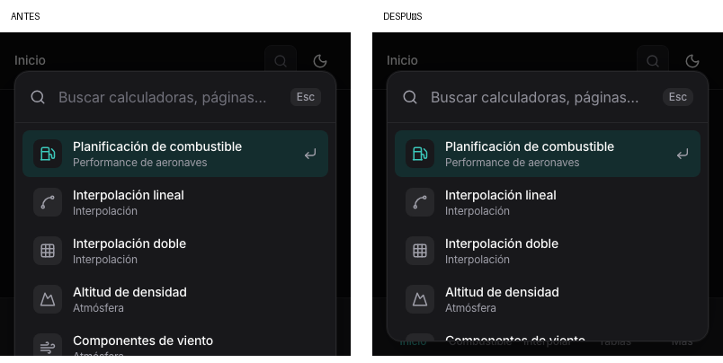
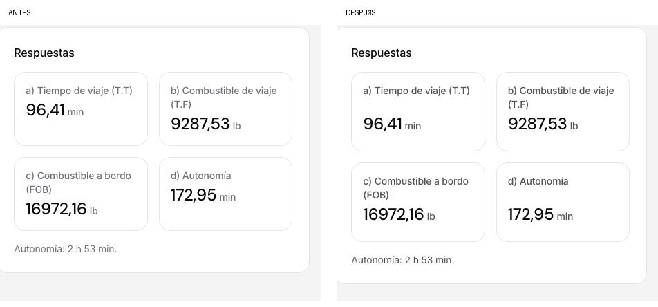

# Revisión visual del rediseño

Revisión realizada el 4 de noviembre de 2026 sobre el rediseño que ya estaba preparado en `main`. Navegador: Chromium 156.0.8078.4, mediante Playwright contra `npm run dev` en `http://127.0.0.1:5173/`.

Se comprobaron anchos de **1280 y 390 px**, con **tema claro y oscuro** y altura de 900 px. La paleta también se probó con 360 px de altura. Se generaron 88 capturas iniciales y 166 finales; este directorio conserva una selección de originales y comparativas relevantes.

## Correcciones

| Archivo:línea | Problema y corrección |
| --- | --- |
| `src/styles/components.css:500` | El resultado largo del historial ocultaba por completo el nombre y el resumen en móvil. La fila ahora dispone el nombre y el resultado en líneas propias, con ajuste de texto. También mejora Actividad reciente. |
| `src/styles/components.css:74` | Los botones de icono conservan su ancho al compartir espacio con texto largo. |
| `src/styles/calc.css:802` | Las respuestas de combustible alinean sus cifras mediante subgrid aunque sus etiquetas ocupen distintas líneas; los valores largos pueden ajustarse. |
| `src/styles/calc.css:1043` | Las tarjetas del desarrollo y las filas del resumen conservan la altura de su contenido; desaparecen las superficies estiradas y los huecos entre filas. |
| `src/styles/calc.css:1056` | La interpolación lineal en móvil reserva más ancho para campos y resultado. La entrada `621.123456` y el resultado `91,957284` se ven completos con seis decimales. |
| `src/styles/layout.css:351` | La paleta limita su altura al espacio disponible y desplaza su lista internamente. A 360 px de alto, deja de salir por debajo de la ventana. |
| `src/components/layout/CommandPalette.tsx:81` | La opción activa permanece visible al recorrer la paleta con las flechas del teclado. En `:137`, el puntero solo cambia la selección al moverse, evitando que el scroll del teclado active una fila situada bajo un puntero inmóvil. |
| `src/styles/layout.css:505` | Se redistribuye el ancho de la barra inferior: «Combustible» se muestra completo a 390 px. |
| `src/styles/layout.css:593` | El menú móvil usa la altura dinámica del viewport. El buscador conserva su ancho en `src/styles/layout.css:637`. |
| `src/styles/tokens.css:128` | Se refuerza el contraste de textos secundarios y tenues en claro, y de textos tenues en oscuro (`:177`, `:218`). El texto de las acciones pasa a tinta sobre el mismo teal (`:138`). |
| `src/styles/tokens.css:89` | Los radios pequeños y de píldora se ajustan a 8 y 48 px; círculos y esquinas de tablas también usan tokens en `calc.css`. Se elimina el token de peso 600 sin uso. |

Los cambios de esta revisión mantienen los textos, atributos ARIA, identificadores de clase protegidos y orden del DOM. Los colores y ambos temas siguen definidos únicamente en `tokens.css`; no se añaden pesos 600/700, degradados, blur ni sombras a tarjetas.

## Cobertura

Cada fila se comprobó en las cuatro combinaciones de ancho y tema.

| Vista | Estados comprobados |
| --- | --- |
| Inicio | Historial vacío, actividad guardada, mosaicos y próximas herramientas |
| Plan de combustible | SPUR–SPJC escrito en el enunciado; respuestas; Datos, Desarrollo y Cómo se calcula abiertos; guardar en historial |
| Interpolación lineal | Ejemplo inicial, régimen de ascenso, variables opcionales y seis decimales |
| Interpolación doble | Matriz, resultado, desarrollo y desplazamiento hasta la última columna |
| Componentes de viento | Campos, resultado y diagrama |
| Altitud de densidad | Campos, resultado, aviso y detalle |
| Conversor | Las siete magnitudes, campos y equivalencias |
| Tablas | Lista y detalle de crucero Mach 0,74, planificación abreviada y espera B737; última columna de cada tabla; filtros Todo/EPR/IAS/FF |
| Pruebas | Lista, detalle SPUR–SPJC y validación 19/19; ejercicio SPJC–SPQT con redirección a la herramienta |
| Historial | Vacío, guardado, varias herramientas y filtro |
| Ajustes | Apariencia, control de precisión y cambio real entre Claro/Oscuro |
| Navegación | ⌘K, paleta en ventana baja, primera/última opción con teclado, menú lateral colapsado, menú móvil abierto y transición de colapsado a móvil |

Para SPUR–SPJC se obtuvo T.T **96,41 min**, T.F **9287,53 lb**, FOB **16972,16 lb** y autonomía **172,95 min**. La prueba compara correctamente los 19 pasos con su resolución manual.

No se detectó scroll horizontal de página ni errores de JavaScript en las cuatro combinaciones. Las tablas y la matriz mantienen desplazamiento horizontal dentro de sus contenedores. Los informes de geometría están en [antes](before-layout.json) y [después](after-layout.json); las comprobaciones adicionales están en [interactions.json](interactions.json) y [palette-keyboard.json](palette-keyboard.json).

## Contraste

Relaciones calculadas sobre los colores efectivos del navegador. Estas mediciones corresponden a los pares indicados, no a una auditoría integral de accesibilidad.

| Par | Antes | Después |
| --- | ---: | ---: |
| Texto secundario / lienzo claro | 4,39:1 | 7,03:1 |
| Texto tenue / tarjeta clara | 2,62:1 | 5,43:1 |
| Texto tenue / tarjeta oscura | 3,67:1 | 5,60:1 |
| Texto tenue / superficie oscura secundaria | 3,09:1 | 4,71:1 |
| Texto de acción / teal, ambos temas | 3,37:1 | 5,91:1 |

Los pares corregidos y el estado hover de la acción superan 4,5:1. Valores completos en [contrast.json](contrast.json).

## Antes y después

Las comparativas conservan el tamaño original de los píxeles; algunas recortan la zona relevante. También se adjuntan los originales completos.

### Historial móvil

[Original antes](before/390-light-historial.png) · [Original después](after/390-light-historial.png)

### Interpolación con seis decimales

[Original antes](before/390-light-precision-lineal.png) · [Original después](after/390-light-precision-lineal.png)

### Paleta en ventana baja, modo oscuro

[Original antes](before/390-dark-paleta-baja.png) · [Original después](after/390-dark-paleta-baja.png)

### Cifras de combustible alineadas

[Original antes](before/1280-light-combustible.png) · [Original después](after/1280-light-combustible.png)

### Capturas adicionales

| Vista | Antes | Después |
| --- | --- | --- |
| Desarrollo SPUR–SPJC abierto | [Captura](before/1280-light-combustible-desarrollo.png) | [Captura](after/1280-light-combustible-desarrollo.png) |
| Menú móvil oscuro abierto | [Captura](before/390-dark-menu-movil.png) | [Captura](after/390-dark-menu-movil.png) |
| Menú lateral oscuro colapsado | [Captura](before/1280-dark-colapsado.png) | [Captura](after/1280-dark-colapsado.png) |

## Verificación final

`npm run build && npx vitest run`: build correcto y **109 tests aprobados en 6 archivos**. Vitest muestra avisos de jsdom sobre `window.scrollTo`, sin fallos; las comprobaciones con Chromium no registraron errores de ejecución.

La [última opción de la paleta con teclado](after/390-dark-paleta-ultima-opcion.png) permanece dentro de la ventana baja.
